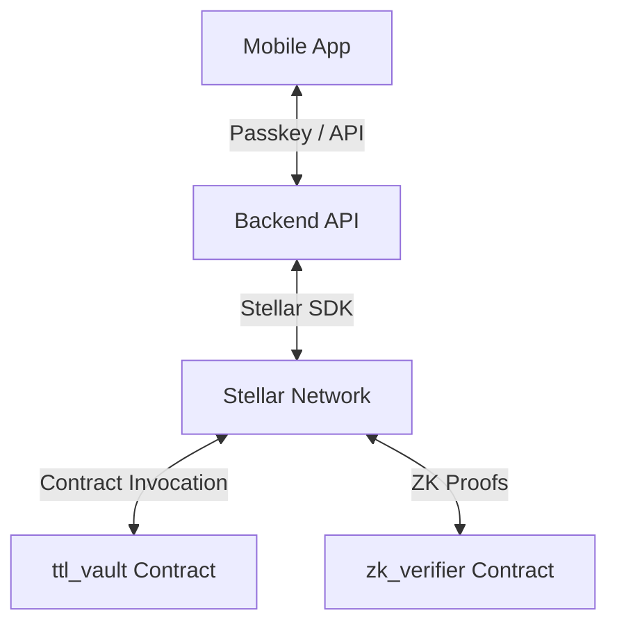
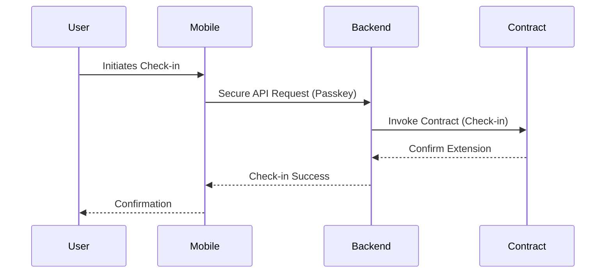
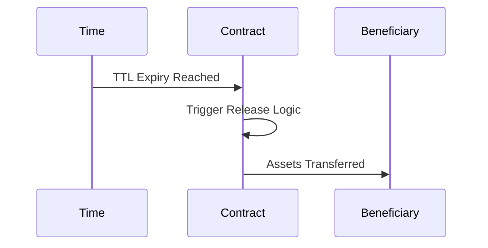

# Architecture Overview

The TTL-Legacy system is a decentralized, secure, and user-friendly platform built on the Stellar blockchain, designed to manage vault lifecycles based on Time-To-Live (TTL) logic.

## Component Diagram

The following diagram illustrates the interaction between the primary system components:



## Technology Stack

| Component | Technology | Rationale |
| :--- | :--- | :--- |
| **Smart Contracts** | Rust / Soroban | Secure, performant, and native to Stellar. |
| **Backend** | Rust / Axum | Type-safe, high-concurrency, efficient performance. |
| **Mobile (Android)** | Kotlin | Native performance, jetpack compose UI. |
| **Mobile (iOS)** | Swift | Native performance, SwiftUI. |
| **Blockchain** | Stellar | Low cost, fast finality, robust smart contract platform. |

## Data Flows

### Full Vault Lifecycle

This sequence shows vault creation and funding, recurring owner check-ins, and release after the owner misses the check-in deadline. Deadline expiry does not execute a transfer by itself; a caller must invoke the contract after the release grace period.

```mermaid
sequenceDiagram
    participant Owner
    participant Mobile
    participant Backend
    participant Contract as ttl_vault Contract
    participant Token as Token Contract
    participant Time
    participant Caller as Beneficiary / Any Caller

    Owner->>Mobile: Create vault with beneficiary and check-in interval
    Mobile->>Backend: Submit authenticated vault request
    Backend->>Contract: create_vault(owner, beneficiary, interval)
    Contract->>Contract: Store locked vault and initial deadline
    Contract-->>Backend: Return vault ID
    Backend-->>Mobile: Confirm vault creation
    Owner->>Mobile: Deposit assets
    Mobile->>Backend: Submit authenticated deposit request
    Backend->>Contract: deposit(vault ID, amount)
    Contract->>Token: Transfer assets into vault
    Token-->>Contract: Confirm deposit

    loop Before each deadline
        Owner->>Mobile: Check in
        Mobile->>Backend: Submit authenticated check-in
        Backend->>Contract: check_in(vault ID)
        Contract->>Contract: Verify check-in and update last_check_in
        Contract-->>Backend: Confirm updated deadline
        Backend-->>Mobile: Check-in success
    end

    Note over Time,Contract: If the owner misses a deadline, the vault becomes logically expired; no transfer runs automatically.
    Time-->>Contract: Check-in deadline passes
    Note over Time,Contract: Soroban may archive inactive state; the release call attempts restoration when needed.
    Note over Time,Caller: Wait until the configured release grace period has elapsed.
    Caller->>Contract: trigger_release(vault ID)
    Contract->>Contract: Restore archived state if needed
    Contract->>Contract: Validate expiry, grace period, release conditions, and balance
    Contract->>Token: Transfer assets to beneficiary
    Token-->>Contract: Confirm transfer
    Contract->>Contract: Mark vault released and emit release event
    Contract-->>Caller: Release confirmed
```

### Check-in Flow

This flow allows the vault owner to prove they are active and extend the TTL.



### Release Flow

When a vault reaches the end of its TTL without a successful check-in, the funds/assets are released to the designated beneficiary.



## Beneficiary Privacy Model

TTL-Legacy operates on a public blockchain, so all contract state is inherently readable by anyone with access to the network. The repository therefore documents the privacy model explicitly instead of pretending the beneficiary is private by default.

### Default behavior

- `Vault.beneficiary` remains stored as a plaintext `Address` for compatibility with existing querying, indexing, and legacy client code.
- The beneficiary is discoverable from on-chain storage before release and can be used by attackers for social engineering.
- This is an intentional tradeoff: it preserves interoperable access patterns and minimizes breaking changes, while acknowledging the transparency of Soroban state.

### Optional privacy layer

- For privacy-sensitive vaults, the owner may commit to the beneficiary using a hash commitment, e.g. `sha256(raw_beneficiary_address_bytes)`.
- The commitment is stored as `BeneficiaryCommitment(u64)` and remains hidden until a later reveal event.
- At release time, anyone can call `reveal_beneficiary` with the raw beneficiary bytes and a proof; the contract verifies the hash and then transfers funds to the revealed address.
- This reduces pre-release targeting exposure, but it is not cryptographic anonymity: the beneficiary becomes public at release, and any public release event or transfer still exposes the final address.

### Design decision

This project treats privacy as a best-effort layer layered on top of public blockchain state, not as a guarantee that all beneficiary identities stay hidden forever. The commitment path is offered as an opt-in mechanism for users who value privacy more than maximum compatibility.

## Check-In Delegation Model

The check-in delegation system lets a vault owner authorise one or more third-party addresses (service providers, automated bots, trusted contacts) to submit check-ins on their behalf without granting any other vault privileges.

### Roles

| Role | Description |
| :--- | :--- |
| **Delegator** | The vault owner. The only address that can add or remove delegates. |
| **Delegate** | An address authorised to call `check_in_as_delegate` for a specific vault. A delegate cannot withdraw funds, update beneficiaries, transfer ownership, or pause the vault. |

### Data Model

Delegation state is stored in two persistent keys per vault:

| Storage Key | Type | Description |
| :--- | :--- | :--- |
| `CheckInDelegates(vault_id)` | `Vec<Address>` | Ordered list of all currently authorised delegates. |
| `CheckInDelegateExpiry(vault_id, delegate)` | `u64` | Optional Unix timestamp after which this specific delegation is invalid. Absent when no expiry was set. |
| `DelegateNonce(vault_id, delegate)` | `u64` | Monotonically incrementing counter used to prevent replay attacks. Starts at 0 and incremented on every accepted delegate check-in. |

### Delegation Scope

A delegate may only call `check_in_as_delegate`. All other state-mutating entry points (`withdraw`, `update_beneficiary`, `transfer_ownership`, etc.) require the vault owner's direct authorisation and are not reachable via a delegation.

The delegate does not need a passkey. `check_in_as_delegate` skips passkey and signature validation and relies solely on Soroban's `require_auth` for the delegate address.

### Expiry

When a delegation is created via `delegate_check_in`, an optional `expiry` timestamp (Unix seconds) can be supplied. At check-in time the contract compares `env.ledger().timestamp()` against the stored expiry. If `now > expiry`, the call returns `DelegateExpired` (error 110) and the nonce is not incremented.

A delegation with no expiry remains valid until explicitly revoked.

### Nonce and Replay Prevention

Every successful `check_in_as_delegate` call must supply a `nonce` value equal to the current stored nonce for `(vault_id, delegate)`. The contract increments the stored nonce after a successful check-in. Submitting a stale or replayed nonce returns `InvalidNonce` (error 83).

Clients must read the current nonce with `get_delegate_nonce(vault_id, delegate)` before constructing a check-in transaction.

### Revocation

The delegator calls `remove_check_in_delegate(vault_id, caller, delegate)` to revoke a delegation immediately. The delegate address is removed from `CheckInDelegates` and the expiry record (if any) is left in storage but becomes unreachable. There is no on-chain grace period after revocation.

| Event Topic | Emitted When |
| :--- | :--- |
| `del_ci` | A delegate is added via `add_check_in_delegate` or `delegate_check_in`. |
| `rev_del` | A delegate is removed via `remove_check_in_delegate`. |

### Trust Assumptions

- The contract trusts Soroban's `require_auth` to verify that the delegate signed the transaction. No additional proof-of-identity is performed.
- Delegate authorisation is vault-scoped. The same address can be a delegate for multiple vaults with independent nonces.
- An admin pause or vault freeze blocks `check_in_as_delegate` exactly as it blocks a direct owner check-in.
- Releasing a vault (`trigger_release`) automatically invalidates all delegations because the vault status changes from `Locked`; subsequent delegate check-in calls return `AlreadyReleased`.

### API Summary

```rust
// Add a permanent delegate (owner only)
add_check_in_delegate(vault_id, caller, delegate) -> Result<(), ContractError>

// Add a delegate with an optional expiry timestamp (owner only)
delegate_check_in(vault_id, caller, delegate_address, expiry: Option<u64>) -> Result<(), ContractError>

// Remove a delegate immediately (owner only)
remove_check_in_delegate(vault_id, caller, delegate) -> Result<(), ContractError>

// Perform a check-in as a registered delegate
check_in_as_delegate(vault_id, caller, nonce) -> Result<(), ContractError>

// Query helpers
get_check_in_delegates(vault_id) -> Vec<Address>
is_check_in_delegate_pub(vault_id, delegate) -> bool
```

---

## Component Documentation

For detailed information on specific components, please refer to the following:

- **Smart Contracts**: `contracts/ttl_vault/src/lib.rs`, `contracts/zk_verifier/src/lib.rs`
- **Backend API**: `docs/backend-api.md`, `docs/openapi.yaml`
- **TTL Logic**: `docs/ttl-logic.md`
- **Mobile Passkeys**: `docs/mobile-passkey-flow.md`, `docs/passkeys.md`
- **ZK Verifier**: `docs/zk-verifier.md`
- **Token Management**: `docs/token-management.md`

## Storage Keys

All contract storage entries are defined in the `StorageKey` enum (`contracts/ttl_vault/src/types.rs`). The enum ensures unique serialization for every key and makes storage usage auditable.

### Instance Keys

| Variant | Type | Description |
| :--- | :--- | :--- |
| `TokenAddress` | `Address` | XLM token contract address |
| `Admin` | `Address` | Contract administrator |
| `Paused` | `bool` | Global contract pause flag |
| `PauseRecord` | `PauseRecord` | Pause/unpause audit record |
| `PendingAdmin` | `Address` | Pending admin transfer |
| `MinCheckInInterval` | `u64` | Minimum check-in interval (seconds) |
| `MaxCheckInInterval` | `u64` | Maximum check-in interval (seconds) |
| `MaxTtlSeconds` | `u64` | Maximum TTL cap (seconds) |
| `TtlDecayRate` | `u64` | TTL decay rate (seconds) |
| `ReleaseGracePeriodSeconds` | `u64` | Grace period after expiry |
| `Version` | `String` | Contract version |
| `MinCheckInCooldown` | `u64` | Minimum check-in cooldown |
| `PendingProtocolConfig` | `ProtocolConfig` | Pending protocol configuration |
| `ProtocolConfigProposedAt` | `u64` | Protocol config proposal timestamp |
| `AdminTransferProposedAt` | `u64` | Admin transfer proposal timestamp |
| `RequireUtf8Metadata` | `bool` | UTF-8 metadata enforcement flag |

### Persistent Keys (per-vault / per-entity)

| Variant | Type | Description |
| :--- | :--- | :--- |
| `Vault(u64)` | `Vault` | Primary vault state |
| `OwnerVaults(Address)` | `Vec<u64>` | Vault IDs owned by an address |
| `MaxVaultsPerOwner` | `u64` | Max vaults per owner limit |
| `BeneficiaryVaults(Address)` | `Vec<u64>` | Vault IDs where address is beneficiary |
| `VaultCount` | `u64` | Total vault count |
| `VestingSchedule(u64, u32)` | `VestingSchedule` | Vesting schedule by vault + index |
| `VestingPenalty(u64, u32)` | `VestingPenaltyConfig` | Vesting penalty config |
| `VestingPendingClaim(u64, u32)` | `VestingPendingClaim` | Pending vesting claim |
| `VestingScheduleCount(u64)` | `u64` | Number of vesting schedules |
| `MilestoneVestingSchedule(u64)` | `MilestoneVestingSchedule` | Milestone-based vesting |
| `CountdownFired(u64)` | `bool` | Countdown notification fired flag |
| `TokenWhitelist(Address)` | `bool` | Token allowlist entry |
| `WrappedToken(Address)` | `bool` | Wrapped token registration flag |
| `VaultMetadata(u64)` | `String` | Vault display metadata |
| `ParentVault(u64)` | `u64` | Parent vault for cloned vaults |
| `VaultPasskeys(u64)` | `Vec<PasskeyHash>` | Vault passkey list |
| `BackupCodes(u64)` | `EncryptedBackupCodes` | Encrypted backup codes |
| `BeneficiaryDelegate(u64)` | `Address` | Check-in delegate |
| `BeneficiaryDelegationChain(u64)` | `Vec<Address>` | Delegation chain |
| `WithdrawalSchedule(u64)` | `Vec<WithdrawalScheduleEntry>` | Scheduled withdrawals |
| `DisputeStatus(u64)` | `DisputeStatus` | Dispute state |
| `ConditionalAcceptance(u64)` | `ConditionalAcceptanceEntry` | Conditional acceptance config |
| `ArchivedVault(u64)` | `ArchivedVaultInfo` | Archived vault snapshot |
| `BridgeConfig(u32)` | `BridgeConfig` | Cross-chain bridge config |
| `TokenConversion(u64)` | `TokenConversion` | Token conversion config |
| `TokenStaking(u64)` | `TokenStaking` | Token staking config |
| `PasskeyUsage(u64)` | `PasskeyUsageStat` | Passkey usage statistics |
| `BeneficiaryStatus(u64)` | `BeneficiaryStatus` | Beneficiary acceptance status |
| `PasskeyExpiry(u64, BytesN<32>)` | `u64` | Passkey expiry timestamp |
| `PendingOwnership(u64)` | `OwnershipTransferRequest` | Pending ownership transfer |
| `PendingBeneficiaryUpdate(u64)` | `PendingBeneficiaryUpdate` | Pending beneficiary update |
| `VaultAuditLog(u64)` | `Vec<AuditEntry>` | Vault audit trail |
| `MultiSigConfig(u64)` | `MultiSigConfig` | Multi-sig configuration |
| `MultiSigProposal(u64, u64)` | `MultiSigProposal` | Multi-sig proposal |
| `MultiSigProposalCount(u64)` | `u64` | Multi-sig proposal counter |
| `MetadataHistory(u64)` | `Vec<MetadataVersionEntry>` | Metadata version history |
| `CustomMetadataHistory(u64)` | `Vec<Bytes>` | Custom metadata history |
| `OwnerVaultCount(Address)` | `u64` | Number of vaults owned |
| `StateTransitionLog(u64)` | `Vec<StateTransitionEntry>` | State transition audit log |
| `PasskeyChallenge(u64, BytesN<32>)` | `PasskeyChallenge` | Passkey authentication challenge |
| `WithdrawalApprovals(u64)` | `Vec<Address>` | Withdrawal approvers |
| `VaultSnapshot(u64, u64)` | `Vault` | Vault state snapshot |
| `VaultSnapshotTimestamps(u64)` | `Vec<u64>` | Snapshot timestamps |
| `CheckInHistory(u64)` | `Vec<CheckInHistoryEntry>` | TTL prediction history |
| `CheckInEntry(u64, u32)` | `CheckInHistoryEntry` | Paginated check-in entry |
| `CheckInHistoryHead(u64)` | `u32` | Ring buffer head pointer |
| `CheckInHistoryLen(u64)` | `u32` | Number of history entries |
| `CheckInStreak(u64)` | `CheckInStreak` | Check-in streak tracking |
| `CheckInNonce(u64)` | `u64` | Proof-of-work nonce |
| `CheckInDelegates(u64)` | `Vec<Address>` | Check-in delegates |
| `DelegateNonce(u64, Address)` | `u64` | Per-delegation nonce |
| `CheckInDelegateExpiry(u64, Address)` | `u64` | Delegate expiry timestamp |
| `ProofOfLife(u64)` | `ProofOfLifeEntry` | Proof-of-life record |
| `ReleaseVotes(u64)` | `Vec<ReleaseVoteEntry>` | Release votes |
| `ReleaseVoteThreshold(u64)` | `u32` | Release vote threshold |
| `BeneficiaryIdentityOracle(u64)` | `Address` | Identity oracle address |
| `BeneficiaryIdentityVerification(u64)` | `BeneficiaryIdentityVerification` | Identity verification record |
| `BeneficiaryReleaseTriggers(u64)` | `Vec<(Address, Vec<ReleaseTrigger>)>` | Per-beneficiary release triggers |
| `BeneficiaryTierThreshold(u64, Address)` | `u32` | Tier threshold |
| `BeneficiaryStatusEntry(u64, Address)` | `BeneficiaryStatus` | Per-beneficiary status |
| `BeneficiaryReleaseConditionVeto(u64)` | `bool` | Veto flag |
| `ReleaseAttempted(u64)` | `bool` | Release attempt flag |
| `Hibernation(u64)` | `HibernationEntry` | Hibernation state |
| `LastCheckInTime(u64)` | `u64` | Last check-in ledger timestamp |
| `VaultDuplicate(Address, Address, u64)` | `u64` | Duplicate vault prevention |
| `BeneficiaryRotationSchedule(u64)` | `Vec<BeneficiaryRotationEntry>` | Rotation schedule |
| `CheckInGeoLog(u64)` | `Vec<GeoCheckInEntry>` | Geographic check-in log |
| `TtlBorrow(u64)` | `TtlBorrowRecord` | TTL borrow record |
| `EncryptedBackupCodes(u64)` | `EncryptedBackupCodes` | Encrypted backup codes |
| `WithdrawalAuditLog(u64)` | `Vec<AuditEntry>` | Withdrawal audit trail |
| `WithdrawalDisputes(u64)` | `DisputeStatus` | Withdrawal dispute state |
| `WithdrawalScheduleValidation(u64)` | `Vec<WithdrawalScheduleEntry>` | Schedule validation records |
| `WithdrawalLimit(u64)` | `WithdrawalLimit` | Withdrawal limits |
| `WithdrawalTracker(u64)` | `WithdrawalTracker` | Withdrawal tracking |
| `WithdrawalWhitelist(u64)` | `Vec<WhitelistEntry>` | Withdrawal whitelist |
| `WithdrawalReversal(u64, u64)` | `WithdrawalReversal` | Withdrawal reversal record |
| `WithdrawalReversalCounter(u64)` | `u64` | Withdrawal reversal counter |
| `VestingCatchUp(u64)` | `VestingCatchUpConfig` | Catch-up vesting config |
| `VestingBonus(u64)` | `VestingBonusConfig` | Vesting bonus config |
| `YieldDistributionConfig(u64)` | `YieldDistributionConfig` | Yield distribution config |
| `Lending(u64)` | `TokenLending` | Token loan record (see [token-management.md](token-management.md#data-model-and-lifecycle)) |
| `TokenCollateral(u64)` | `TokenCollateral` | Token collateral config |
| `TokenHedge(u64)` | `TokenHedge` | Token hedging config |
| `TokenRebalance(u64)` | `TokenRebalanceConfig` | Token rebalance config |
| `BeneficiaryPool(u64)` | `BeneficiaryPool` | Beneficiary pool config |
| `BeneficiaryPoolAlloc(u64)` | `Vec<u128>` | Pool allocation amounts |
| `BeneficiaryVestingSchedule(u64, Address)` | `VestingSchedule` | Per-beneficiary vesting |
| `BeneficiaryVestingCount(u64)` | `u32` | Per-beneficiary schedule count |
| `BeneficiaryAuction(u64)` | `BeneficiaryAuction` | Beneficiary auction |
| `BeneficiaryAuctionBid(u64, Address)` | `i128` | Auction bid amount |
| `BeneficiaryAuctionCount` | `u64` | Auction counter |
| `PendingMultiSigOp(u64, u64)` | `MultiSigOperation` | Pending multi-sig operation |
| `PendingMultiSigOpNonce(u64)` | `u64` | Multi-sig nonce counter |
| `PendingUpgrade` | `UpgradeProposal` | Pending upgrade proposal |
| `AllowedTokens` | `Vec<Address>` | Token allowlist |
| `OpenProposals(u64)` | `u64` | Open proposal count |
| `TwoFactorConfig(u64)` | `bool` | 2FA config flag |
| `TwoFactorVerified(u64)` | `bool` | 2FA verified flag |
| `VaultFrozen(u64)` | `bool` | Admin freeze flag |
| `ReleaseConditions(u64)` | `Vec<ReleaseCondition>` | Release conditions |
| `ReleaseGracePeriodSeconds` | `u64` | Release grace period |
| `VestingMilestones(u64)` | `Vec<VestingMilestone>` | Vesting milestones |
| `VestingMilestoneCount(u64)` | `u64` | Milestone count |
| `VestingRollover(u64)` | `bool` | Vesting rollover flag |
| `VestingForfeiture(u64)` | `bool` | Vesting forfeiture flag |
| `VestingAcceleration(u64)` | `bool` | Acceleration on death flag |
| `VestingStagger(u64)` | `bool` | Staggered vesting flag |
| `WithdrawalProof(u64, u64)` | `WithdrawalProof` | Withdrawal proof |
| `WithdrawalEscrow(u64)` | `WithdrawalEscrow` | Escrowed withdrawal |
| `WithdrawalRollback(u64)` | `WithdrawalRollback` | Rollback record |
| `WithdrawalRateLimit(u64)` | `WithdrawalRateLimit` | Rate limit config |
| `RevealedBeneficiary(u64)` | `Address` | Revealed beneficiary |
| `BeneficiaryCommitment(u64)` | `BytesN<32>` | Beneficiary commitment |
| `RecoveryContacts(u64)` | `Vec<Address>` | Recovery contacts |
| `PasskeyRecoveryRequest(u64)` | `PasskeyRecoveryRequest` | Recovery request |
| `PasskeyRotationPolicy(u64)` | `PasskeyRotationPolicy` | Rotation policy |
| `LastVaultPasskeyRotation(u64)` | `u64` | Timestamp of last `rotate_passkey` (enforces policy minimum interval) |
| `CustomMetadataHistory(u64)` | `Vec<Bytes>` | Custom metadata history |
| `ReleaseVoteThreshold(u64)` | `u32` | Release vote threshold |
| `VestingScheduleCount(u64)` | `u64` | Number of schedules |
