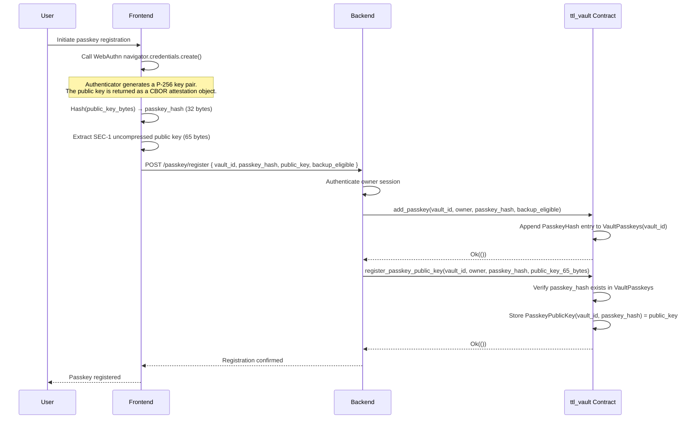
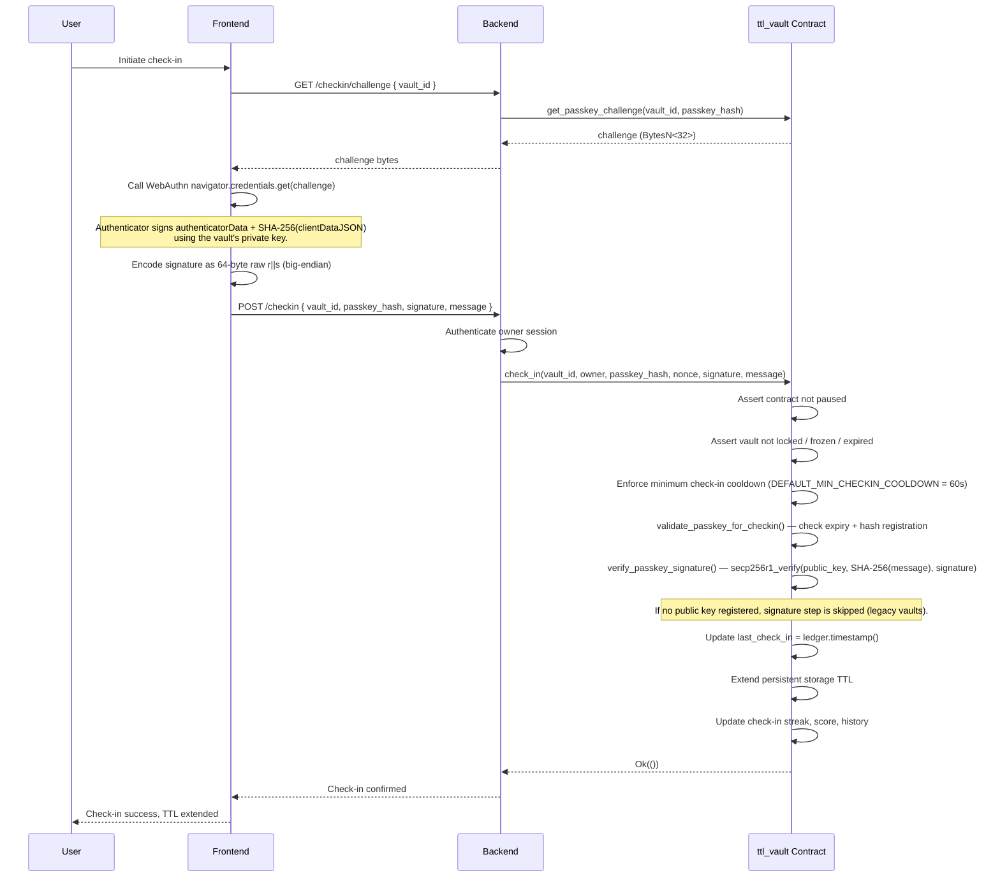
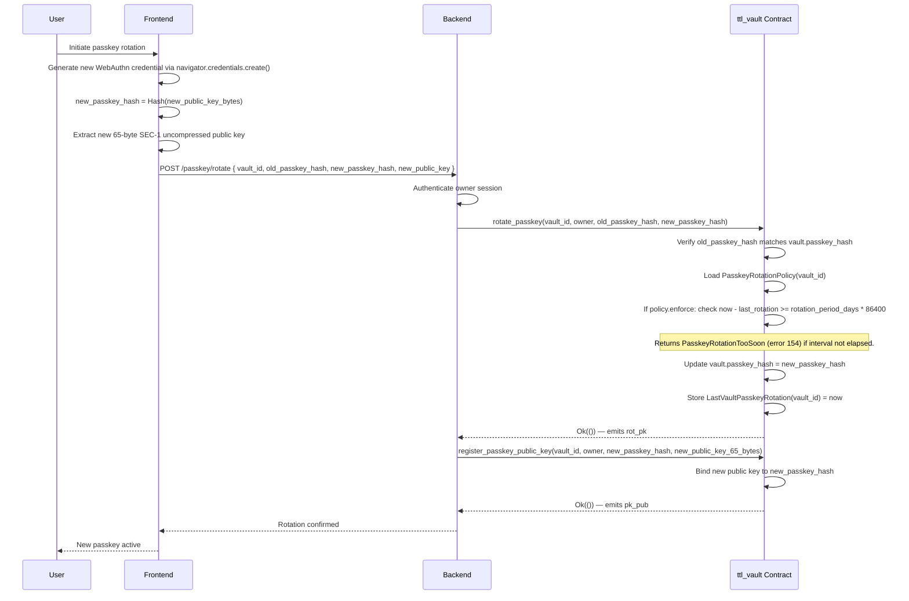

# Passkey Flows

This document covers the three passkey lifecycle flows using Mermaid sequence diagrams: registration, passkey-authenticated check-in, and passkey rotation.

---

## 1. Passkey Registration

Passkey registration binds a WebAuthn credential to a vault. It is a two-phase process: the frontend generates the credential and stores the hash on-chain; optionally, the owner then registers the secp256r1 public key to enable full on-chain signature verification.

**Key contract functions:**
- `add_passkey(vault_id, caller, passkey_hash, backup_eligible)` — appends the hash to the vault's passkey list and emits `add_pk`.
- `register_passkey_public_key(vault_id, caller, passkey_hash, public_key)` — binds the 65-byte SEC-1 uncompressed public key to the hash, enabling on-chain secp256r1 signature verification. Emits `pk_pub`.

---

## 2. Passkey-Authenticated Check-In

After registration, the owner proves liveness by signing a check-in with their passkey. The contract verifies the signature on-chain and extends the vault's TTL.

**Key contract functions:**
- `check_in(vault_id, caller, passkey_hash, nonce, signature, message)` — primary owner check-in entry point. Emits `check_in` and `ci_rec`.

**Validation order inside `check_in`:**
1. Contract-level pause guard.
2. Vault-level pause and freeze guards.
3. Owner or delegate identity check.
4. Per-delegation nonce check (delegates only).
5. Vault status and expiry checks.
6. Minimum cooldown rate limit.
7. Passkey registration and expiry validation.
8. secp256r1 signature verification (if a public key is registered).

---

## 3. Passkey Rotation

Passkey rotation replaces the primary passkey with a new credential. A configurable rotation policy can enforce a minimum interval between rotations.

**Key contract functions:**
- `rotate_passkey(vault_id, caller, old_passkey_hash, new_passkey_hash)` — atomically replaces the primary passkey. Enforces rotation policy if configured. Emits `rot_pk`.
- `set_passkey_rotation_policy(vault_id, caller, policy)` — configures the minimum rotation interval (`rotation_period_days`) and whether it is enforced. Only the vault owner can call this.

**Rotation policy fields (`PasskeyRotationPolicy`):**

| Field | Type | Description |
| :--- | :--- | :--- |
| `rotation_period_days` | `u32` | Minimum days between rotations. `0` disables the interval check. |
| `enforce` | `bool` | When `false`, the policy is advisory only and does not block rotation. |

**Relevant events:**

| Topic | Emitted By | Payload |
| :--- | :--- | :--- |
| `add_pk` | `add_passkey` | `(passkey_hash, backup_eligible)` |
| `pk_pub` | `register_passkey_public_key` | `passkey_hash` |
| `rot_pk` | `rotate_passkey` | `(old_passkey_hash, new_passkey_hash)` |
| `rm_pk` | `remove_passkey` | `passkey_hash` |
| `pk_revoke` | internal revocation path | `passkey_hash` |
| `pk_expd` | check-in with expired passkey | `passkey_hash` |
| `pk_comp` | compromise detected/reported | `(vault_id, passkey_hash)` |
| `pk_lock` | lockout triggered | `vault_id` |
